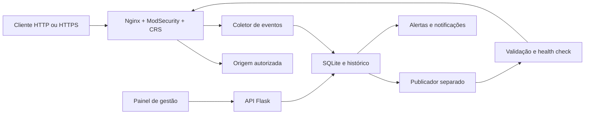

# Arquitetura — Ananim Shield

Diagrama lógico, sem endereços, credenciais ou topologia de clientes.

## Decisões de engenharia

### Plano de gestão separado

O backend web não recebe acesso irrestrito ao Docker; um publicador separado processa configurações validadas.

### Estado aplicado explícito

Cadastro, rascunho, publicação e tráfego observado são estados diferentes. A interface e a operação precisam preservá-los.

### Rollback como parte do fluxo

Uma candidata só deve substituir a configuração válida após validação e checagens de saúde; falhas exigem preservação ou retorno controlado.

### Observabilidade da própria proteção

Alertas locais são complementados por verificações externas, evitando depender exclusivamente de um componente que pode estar indisponível.

## Validação e operação

A validação de mudanças deve distinguir sintaxe/build, testes isolados, publicação e comportamento real. Um processo iniciado, uma resposta HTTP ou um botão habilitado não comprovam, isoladamente, o resultado esperado. Os detalhes operacionais, credenciais e registros de clientes ficam fora deste repositório.

## Fronteiras de responsabilidade

- WAF não substitui correções na aplicação, autenticação, autorização ou proteção DDoS volumétrica.
- A eficácia depende do tráfego, configuração, tuning e atualização do motor e das regras.
- Alta disponibilidade e recuperação externa não são apresentadas como entregas concluídas neste portfólio.
- A documentação não afirma ausência de vulnerabilidades nem certificação de segurança.
- Não são publicados endpoints administrativos, certificados, regras particulares de clientes ou relatórios internos de vulnerabilidades.
