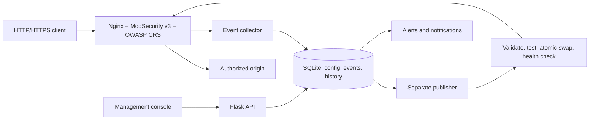
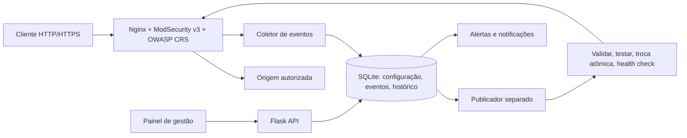

# Architecture — Shield

[English](#english) · [Português](#português)

## English

Logical diagram — no addresses, credentials or client topology.

### Engineering decisions

- **Separate management plane** — the web backend never gets unrestricted Docker access; a separate publisher processes validated configurations.
- **Explicit applied state** — registry, draft, published version and observed traffic are different states, and the UI keeps them apart (desired revision vs applied version).
- **Rollback as part of the flow** — a candidate replaces the valid configuration only after validation, an engine test and health checks; on failure the previous one is preserved or restored.
- **Observability of the protection itself** — local alerts are complemented by external checks, so detection does not depend only on a component that might be down.
- **Privacy in events** — paths/parameters are redacted, bodies, cookies and credentials are not stored.
- **White-label and multi-tenant** — clients, applications and users are tenant-scoped; roles are per client; branding is configuration.

### Validation

Changes are validated at separate levels: syntax/build, isolated tests, deployment and real behavior with real traffic.

### Limits

- A WAF does not replace fixes in the application, authentication, authorization or volumetric DDoS protection.
- Effectiveness depends on traffic, configuration, tuning and keeping engine and rules updated.
- Administrative endpoints, certificates, client rules and internal vulnerability reports are not published.

## Português

Diagrama lógico — sem endereços, credenciais ou topologia de clientes.

### Decisões de engenharia

- **Plano de gestão separado** — o backend web nunca recebe acesso irrestrito ao Docker; um publicador separado processa configurações validadas.
- **Estado aplicado explícito** — cadastro, rascunho, versão publicada e tráfego observado são estados diferentes, e a interface os mantém separados (revisão desejada × versão aplicada).
- **Rollback como parte do fluxo** — a candidata só substitui a configuração válida após validação, teste do motor e health check; em falha, a anterior é preservada ou restaurada.
- **Observabilidade da própria proteção** — alertas locais complementados por verificações externas, para não depender só de um componente que pode estar fora.
- **Privacidade nos eventos** — caminhos/parâmetros redigidos; corpo, cookies e credenciais não são armazenados.
- **White-label e multi-tenant** — clientes, aplicações e usuários têm escopo por cliente; perfis por cliente; marca é configuração.

### Validação

Mudanças são validadas em níveis separados: sintaxe/build, testes isolados, publicação e comportamento real com tráfego real.

### Limites

- WAF não substitui correções na aplicação, autenticação, autorização ou proteção DDoS volumétrica.
- A eficácia depende do tráfego, configuração, tuning e atualização do motor e das regras.
- Endpoints administrativos, certificados, regras de clientes e relatórios internos de vulnerabilidade não são publicados.
