# Shield

**Application Security & WAF** — application protection with controlled changes.

[English](README.md) · [Português](README.pt-BR.md)

A protection layer for HTTP/HTTPS applications with a management console, policies, events, alerts and a controlled publishing flow. It combines a recognized WAF engine (Nginx + ModSecurity + OWASP CRS) with management and operations components built to organize rules, explain decisions and roll back changes safely.

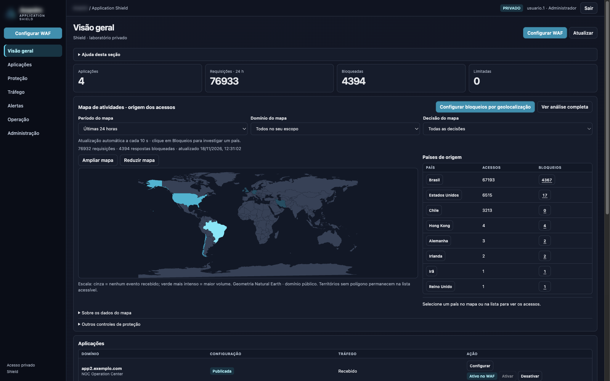

> **Portfolio of Gustavo Souza.** **About the screenshots:** they are real captures of the production interface (November 2026). Client names, hostnames, IP addresses, users, e-mails and domains were replaced automatically at capture time by fictitious ones (e.g. `CLIENTE ALFA`, `app2.exemplo.com`, `usuario.1`, `10.20.x.x`); cloud account names and the operator's brand are blurred; financial values are scrambled. Layout, features and workflows are exactly what runs in production.

## The problem

Turning on protection rules without context can block legitimate traffic. The challenge is to manage applications, origins, policies and exceptions with traceability, keep *draft* separate from *applied* configuration, and detect failures without depending on the console being up.

## At a glance

| Area | What it delivers |
|---|---|
| **Per-application management** | Clients, applications, origins and policies; enable/disable per domain. |
| **Inspection & policies** | OWASP CRS families with blocking by anomaly score, custom rules, limits, OpenAPI contracts. |
| **Access control** | Country, IP/CIDR and ASN rules, MFA for protected access, request simulator. |
| **Scoped exceptions** | Rule + path + scope + justification + expiry; no global bypass. |
| **Publishing & rollback** | Drafts, versioned snapshots, validation, atomic swap, health check, one-click revert. |
| **Events & analytics** | Redacted events, map, block rate, CRS detections, reports. |
| **Alerts** | Origin down, HTTP 5xx, block spikes, certificate expiry, collection stopped. |
| **Admin & audit** | SSO + MFA, per-client roles, full audit trail. |

<table><tr><td width="33%"> Overview</td><td width="33%">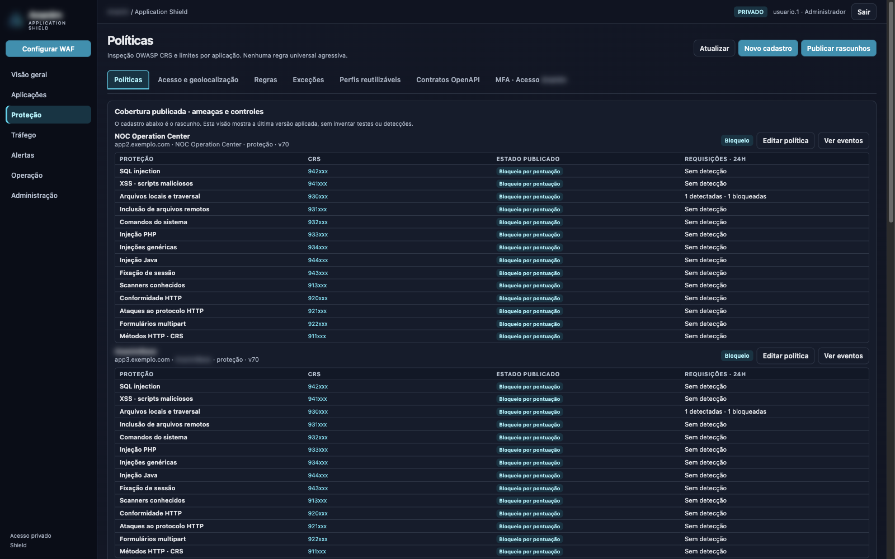 Policies & published coverage</td><td width="33%">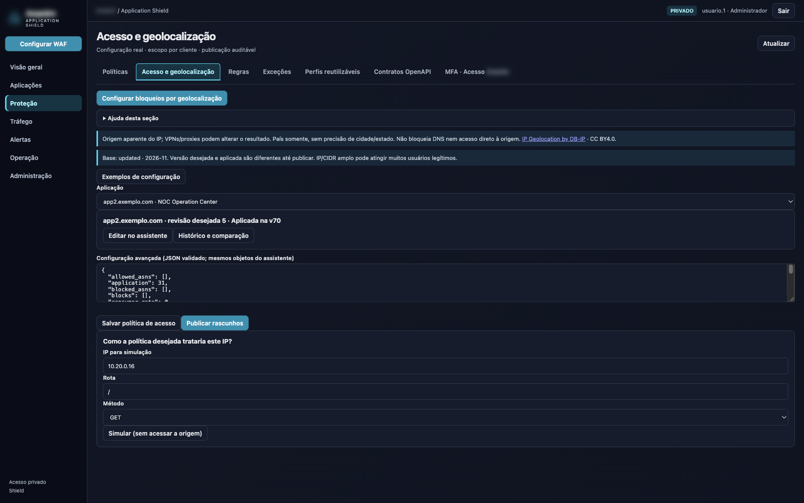 Access & geolocation</td></tr><tr><td width="33%">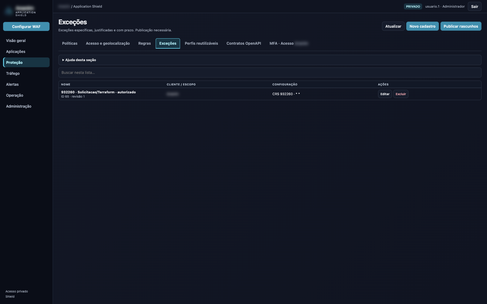 Scoped exceptions</td><td width="33%">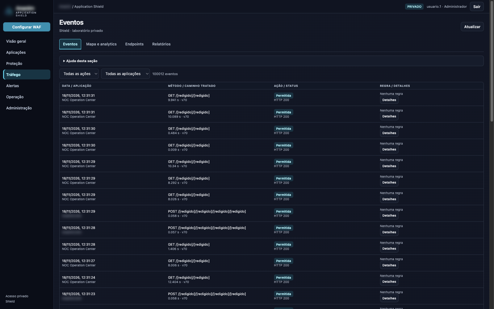 Events</td><td width="33%">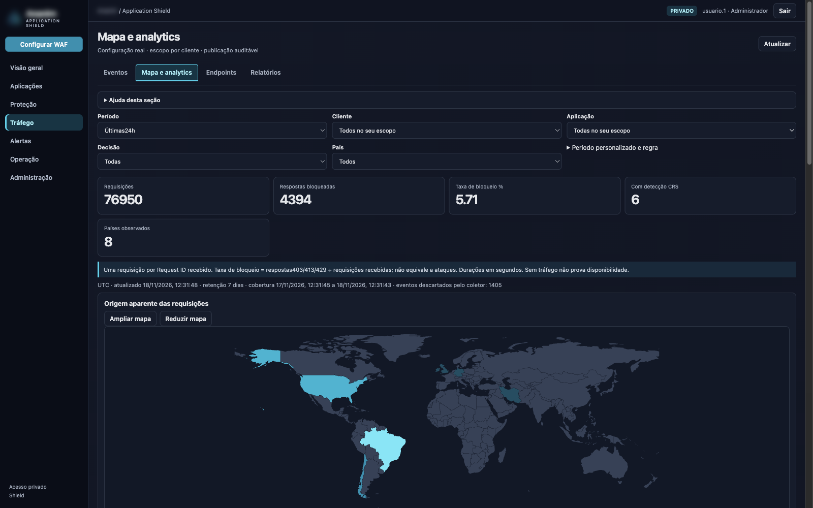 Map & analytics</td></tr></table>

## White-label and SaaS-ready

Shield was built to be **white-label**. Brand name, logo, colors, report letterhead, tenant list, cloud accounts and integrations are configuration — not hard-coded. The same platform can be:

- **deployed for any company** — an MSP, a cloud reseller, a managed-services provider or an internal IT team;
- **run single-tenant** (one company, on its own infrastructure) or **multi-tenant**, with every tenant isolated by scope validated in the backend;
- **offered as a SaaS**, with per-tenant onboarding, role-based access and MFA already part of the design.

Clients, applications, origins, policies and users are all tenant-scoped data. A provider can protect its customers' applications from one control plane, give each customer a scoped login (reader / operator) and keep the global publish permission with its own team.

Adapting it to a new company means configuring branding, connectors and credentials for that environment and validating them with its own data.

## Screen-by-screen tour

### 1. Overview

- Protected applications, requests in the last 24 h, blocked and rate-limited requests.
- World map of request origins with one-click geolocation blocking.
- Per-domain application list with enable/disable, and health of each component: proxy, publisher, event collector, scanner.

### 2. Policies & published coverage

- Per application, the **published** protection against each threat family of the OWASP Core Rule Set: SQL injection, XSS, path traversal, RFI, command injection, PHP / Java / generic injection, session fixation, scanners, HTTP protocol and multipart attacks.
- Shows the state actually applied (blocking by anomaly score) and detections/blocks in the last 24 h — no invented tests.
- Edit policy and jump to related events.

### 3. Access & geolocation

- Country blocking, IP/CIDR and ASN allow/deny lists per application, through a guided assistant or validated JSON.
- Desired revision vs applied version shown side by side, with history and diff.
- **Simulator**: test how the desired policy would treat an IP, route and method — without touching the origin.

### 4. Scoped exceptions

- False positives handled with specific exceptions: rule ID, path, client scope, justification and expiry.
- Exceptions are drafts until published — no global bypass.
- Also in this section: custom rules evaluated before the CRS, reusable profiles, OpenAPI contracts and MFA for protected access.

### 5. Events

- Every decision with application, rule, action, status code and apparent origin.
- Sensitive data is redacted: paths and parameters are stored as `[redacted]`; bodies, cookies and credentials are not persisted.

### 6. Map & analytics

- Block rate, CRS detections, countries observed and request volume over time, with 7-day retention.
- Filters by client, application, decision and country.

### 7. Reports

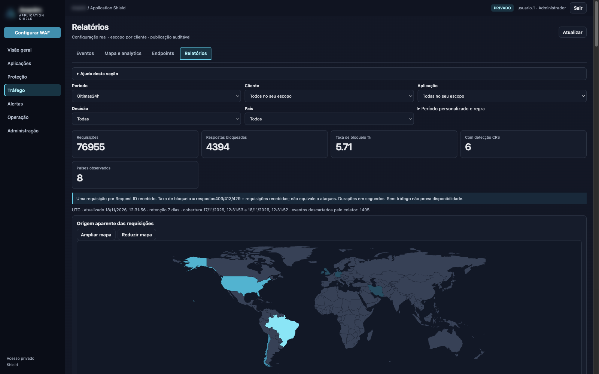

- Traffic and security report by period, client, application, decision and country — with coverage window and collector-discard counters shown honestly.
- Origin map, top rules, top paths and endpoints.

### 8. Alerts

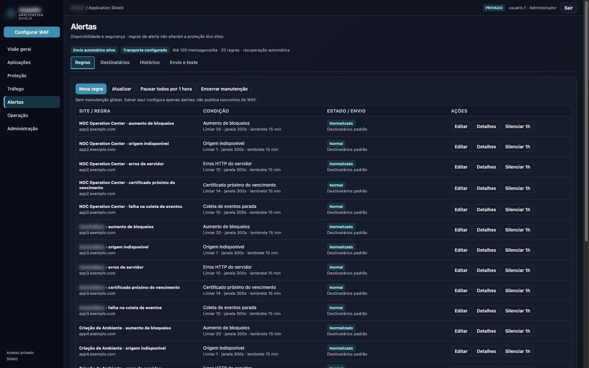

- Rules per application: block increase, origin down, server HTTP errors, certificate close to expiry, event collection stopped.
- Threshold, window and reminder per rule; recipients, history, test sending; silence 1 h, pause all, maintenance mode.
- Alert rules never change the protection itself.

### 9. Versioned publishing & rollback

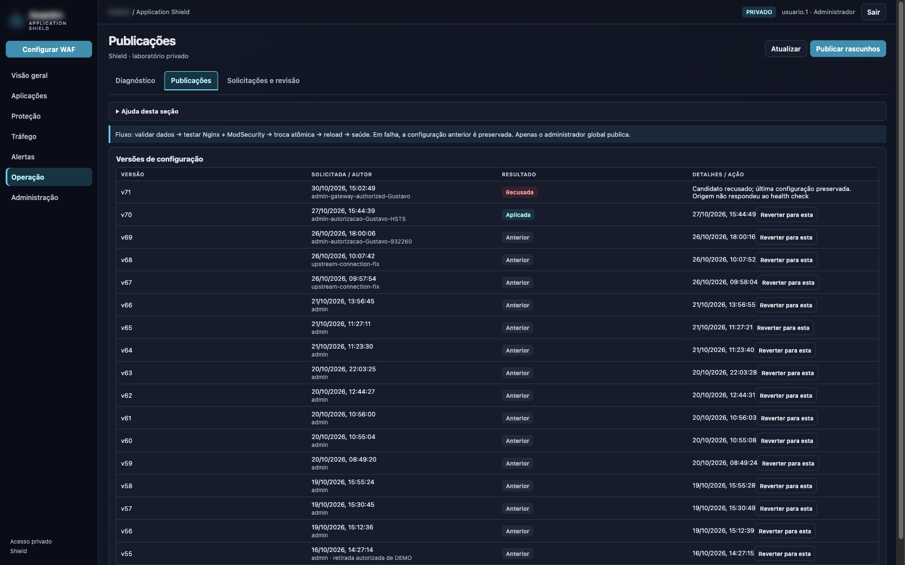

- Flow: validate data → test Nginx + ModSecurity → atomic swap → reload → health check. If anything fails, the previous configuration is kept.
- Every version listed with author, result (applied / rejected / previous) and **one-click revert**.
- Diagnostics (DNS pointing to the WAF, origin reachability) and a request/review queue in the same area.

### 10. Audit

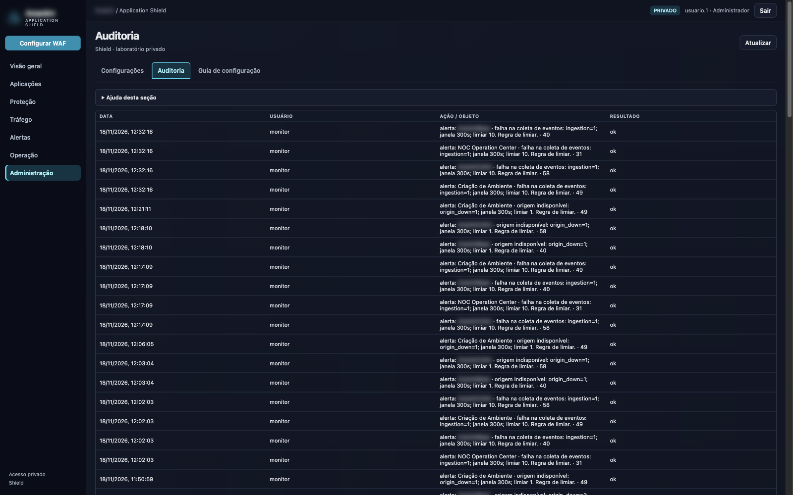

- Audit trail of every action by users and by the monitor: who, when, what object, result.
- Administration with SSO + MFA, roles (Administrator / Operator / Reader) scoped per client, and a built-in configuration guide.

## How it works

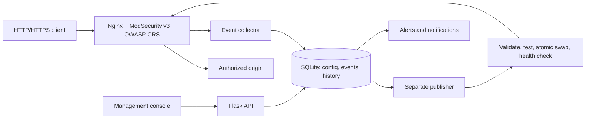

**Stack:** Nginx · ModSecurity v3 · OWASP CRS · Python · Flask · Gunicorn · SQLite · Docker · JavaScript · SSO/MFA gateway.

Architecture decisions and limits: [ARCHITECTURE.md](ARCHITECTURE.md) · Evolution ideas: [ROADMAP.md](ROADMAP.md) · Screenshot notes: [VISUALS.md](VISUALS.md)

## Example

An application starts in observation mode while legitimate traffic is studied. A false positive is handled with a specific exception, reviewed and published. The publisher validates the candidate and checks health; if anything fails, the valid configuration is kept or restored. Events and reports confirm the decision that was applied.

## Skills demonstrated

- Turning security requirements into a usable, auditable console.
- Separating management plane from traffic plane (the web backend has no direct Docker access).
- Safe change management: drafts, validation, atomic publish, rollback.
- Privacy by design in logs (redaction, no bodies/cookies/credentials).
- Honest documentation of what a WAF does and does not cover.

## Important limits

- A WAF does not replace fixes in the application, authentication, authorization or volumetric DDoS protection.
- Effectiveness depends on traffic, configuration, tuning and keeping engine and rules updated.
- High availability and external recovery are not presented as finished deliverables.
- No claim of absence of vulnerabilities or security certification.

## Source code

The source code is kept in a private repository. This repository is a portfolio: documentation and screenshots only — no operational code, credentials, access to environments or client data. Third-party trademarks and components remain subject to their own rights and licenses.

## Related projects

- [NOC Operation Center](https://github.com/gsouzacloud/noc-operation-center-portfolio) — operations, correlation, users & security
- [Cloud Report](https://github.com/gsouzacloud/cloud-report-portfolio) — cloud FinOps & governance
- [Shield](https://github.com/gsouzacloud/shield-portfolio) — WAF & application security

[Gustavo Souza on GitHub](https://github.com/gsouzacloud) · Documentation updated November 18, 2026.
