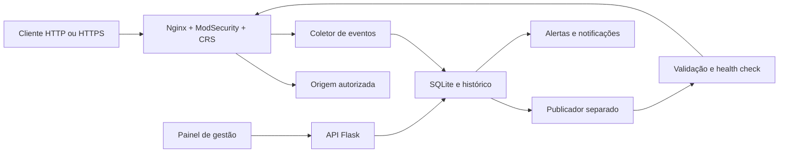

# Ananim Shield

**Application Security & WAF**  
Proteção de aplicações com mudanças controladas.

Camada de proteção de aplicações HTTP/HTTPS com painel de gestão, políticas, eventos e um fluxo controlado de publicação. Combina um motor WAF reconhecido com componentes de gestão e operação construídos para organizar regras, explicar decisões e reverter mudanças.

> **Portfólio público de Gustavo Souza.** Este repositório apresenta o projeto; não contém o código operacional, acesso a ambientes ou dados de clientes. A imagem é uma composição demonstrativa baseada nas funcionalidades descritas, não uma captura da produção. Números e entidades são fictícios.

## O problema que o projeto resolve

Ativar regras de proteção sem contexto pode bloquear tráfego legítimo. O desafio é administrar aplicações, origens, políticas e exceções com rastreabilidade, separar rascunho de configuração aplicada e detectar falhas sem depender do painel estar disponível.

## O que faz hoje

A relação abaixo foi preparada a partir dos módulos e registros técnicos do projeto. Não representa uma nova auditoria de produção ou promessa de cobertura universal.

| Área | Capacidade implementada | Aplicação prática |
|---|---|---|
| Gestão por aplicação | Cadastro de clientes, aplicações, origens e políticas. | Organizar proteção e responsabilidade sem transformar o backend web em um shell administrativo. |
| Inspeção e políticas | Modos de observação e bloqueio, regras CRS, regras adicionais e limites por aplicação. | Ajustar proteção a partir de tráfego legítimo e eventos correlacionados. |
| Exceções delimitadas | Exceções com escopo, justificativa e prazo, conforme o mecanismo implementado. | Tratar falsos positivos sem criar uma liberação geral do motor. |
| Publicação e rollback | Rascunhos, snapshots versionados, validação de configuração, aplicação controlada e retorno à versão válida. | Evitar confundir um cadastro salvo com uma política efetivamente aplicada. |
| Eventos e decisões | Eventos com contexto de regra, aplicação, decisão e origem observada. | Explicar um bloqueio sem persistir indiscriminadamente corpos, cookies ou credenciais. |
| Alertas operacionais | Condições de origem, HTTP, latência, bloqueios, certificados e coleta; fila e histórico. | Acompanhar a saúde da proteção e do caminho até a aplicação. |
| Acesso administrativo | Camadas de certificado de cliente, MFA e autenticação do painel no desenho implantado. | Restringir a administração e manter separação entre plano de gestão e tráfego protegido. |

## Como funciona

**Stack:** Nginx · ModSecurity v3 · OWASP CRS · Python · Flask · Gunicorn · SQLite · Docker · JavaScript · Authelia.

Veja as decisões e os limites da arquitetura em [ARCHITECTURE.md](ARCHITECTURE.md).

## Exemplo de uso

Uma aplicação passa por observação de tráfego e ajuste de política. Um falso positivo é tratado com uma exceção específica, revisada e publicada. O publicador valida a candidata e verifica saúde; se houver falha, preserva ou restaura a configuração válida. Os eventos permitem conferir a decisão aplicada.

## Competências demonstradas

- Traduzir necessidades operacionais em uma aplicação utilizável.
- Integrar fontes de dados e preservar o significado de cada informação.
- Projetar controles de acesso, rastreabilidade e limites operacionais.
- Construir interfaces que apoiam diagnóstico e decisão.
- Documentar trade-offs, validação e caminhos de evolução.

## O que pode evoluir

As propostas de [ROADMAP.md](ROADMAP.md) estão separadas dos recursos existentes. Elas não são apresentadas como funcionalidades já entregues.

## Limites importantes

- WAF não substitui correções na aplicação, autenticação, autorização ou proteção DDoS volumétrica.
- A eficácia depende do tráfego, configuração, tuning e atualização do motor e das regras.
- Alta disponibilidade e recuperação externa não são apresentadas como entregas concluídas neste portfólio.
- A documentação não afirma ausência de vulnerabilidades nem certificação de segurança.
- Não são publicados endpoints administrativos, certificados, regras particulares de clientes ou relatórios internos de vulnerabilidades.

## Sobre as imagens e o código

As telas deste repositório usam somente conteúdo fictício e ilustram a proposta funcional. A aparência da produção pode diferir. Não há dados operacionais embutidos, links de acesso aos ambientes ou demonstração conectada a sistemas reais.

O código-fonte é mantido em repositório privado. Não existe autorização de uso ou distribuição do sistema operacional por meio deste repositório. Marcas e componentes de terceiros permanecem sujeitos aos direitos e licenças correspondentes.

## English overview

An application security and WAF management project built around Nginx, ModSecurity and OWASP CRS. The custom layer covers policy management, scoped exceptions, versioned publishing, rollback, events and alerting. The underlying inspection engine is third-party software, not presented as an original engine developed from scratch.

## Projetos relacionados

- [AnanimCloudReport](https://github.com/gsouzacloud/ananim-cloud-report-portfolio)
- [Ananim NOC](https://github.com/gsouzacloud/ananim-noc-portfolio)
- [Ananim Shield](https://github.com/gsouzacloud/ananim-application-shield-portfolio)

[Perfil de Gustavo Souza](https://github.com/gsouzacloud) · Documentação preparada em 18/11/2026.
