# Shield

**Segurança de Aplicações e WAF** — proteção de aplicações com mudanças controladas.

[English](README.md) · [Português](README.pt-BR.md)

Camada de proteção para aplicações HTTP/HTTPS com painel de gestão, políticas, eventos, alertas e um fluxo controlado de publicação. Combina um motor WAF reconhecido (Nginx + ModSecurity + OWASP CRS) com componentes de gestão e operação construídos para organizar regras, explicar decisões e reverter mudanças com segurança.

> **Portfólio de Gustavo Souza.** **Sobre as imagens:** são capturas reais da interface em produção (novembro/2026). Nomes de clientes, hostnames, IPs, usuários, e-mails e domínios foram substituídos automaticamente no momento da captura por nomes fictícios (ex.: `CLIENTE ALFA`, `app2.exemplo.com`, `usuario.1`, `10.20.x.x`); nomes das contas cloud e a marca da operadora aparecem borrados; valores financeiros estão embaralhados. Layout, funcionalidades e fluxos são exatamente os que rodam em produção.

## O problema

Ativar regras de proteção sem contexto pode bloquear tráfego legítimo. O desafio é administrar aplicações, origens, políticas e exceções com rastreabilidade, separar configuração *rascunho* de configuração *aplicada* e detectar falhas sem depender do painel estar no ar.

## Resumo

| Área | O que entrega |
|---|---|
| **Gestão por aplicação** | Clientes, aplicações, origens e políticas; ativar/desativar por domínio. |
| **Inspeção e políticas** | Famílias do OWASP CRS com bloqueio por pontuação, regras próprias, limites, contratos OpenAPI. |
| **Controle de acesso** | Regras por país, IP/CIDR e ASN, MFA para acesso protegido, simulador de requisição. |
| **Exceções delimitadas** | Regra + caminho + escopo + justificativa + prazo; sem liberação global. |
| **Publicação e rollback** | Rascunhos, snapshots versionados, validação, troca atômica, health check, reverter com um clique. |
| **Eventos e analytics** | Eventos redigidos, mapa, taxa de bloqueio, detecções CRS, relatórios. |
| **Alertas** | Origem indisponível, HTTP 5xx, aumento de bloqueios, vencimento de certificado, coleta parada. |
| **Administração e auditoria** | SSO + MFA, perfis por cliente, trilha de auditoria completa. |

<table><tr><td width="33%">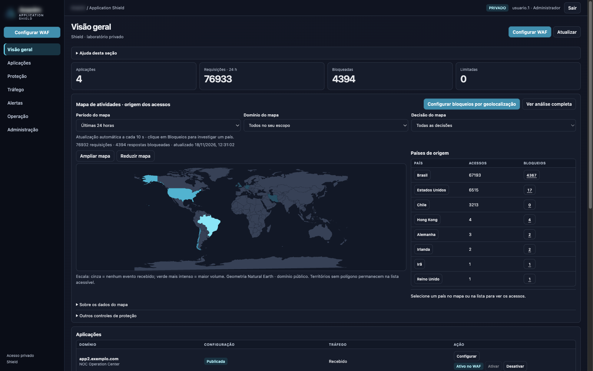 Visão geral</td><td width="33%">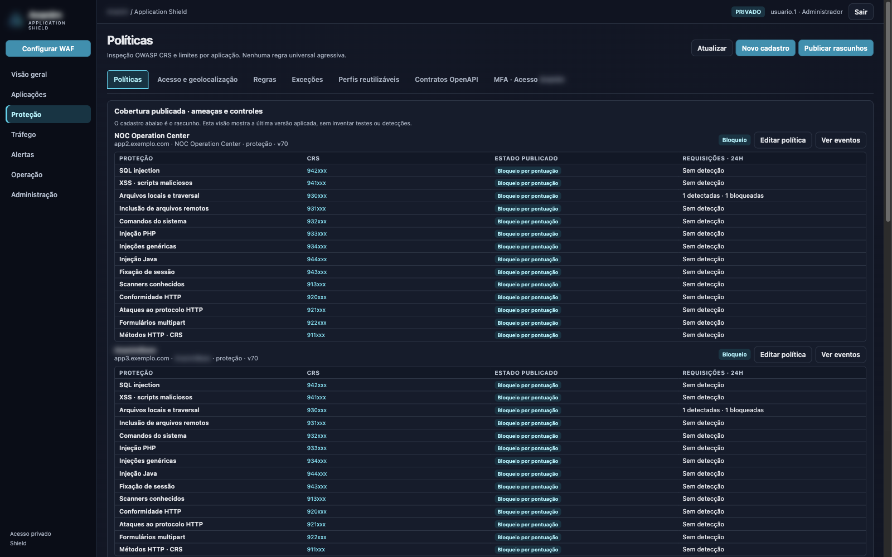 Políticas e cobertura publicada</td><td width="33%">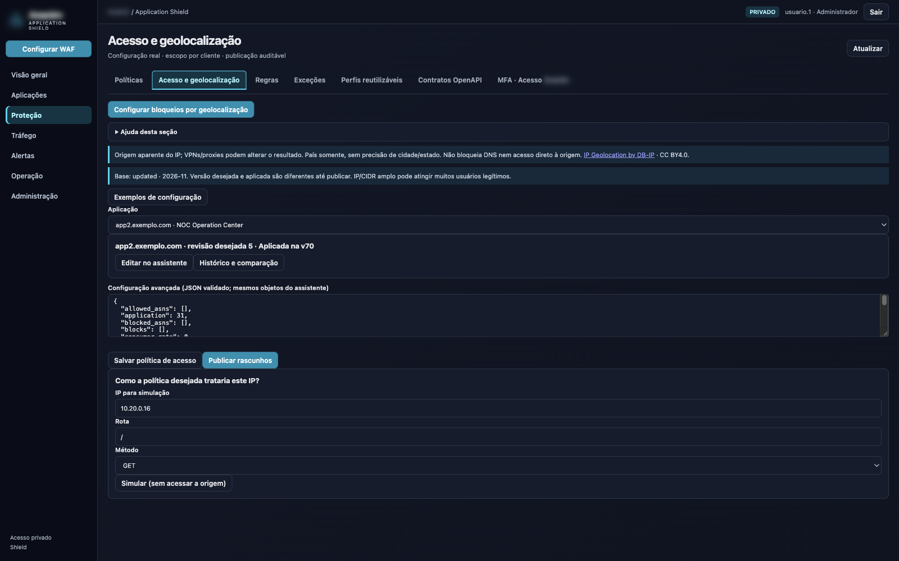 Acesso e geolocalização</td></tr><tr><td width="33%">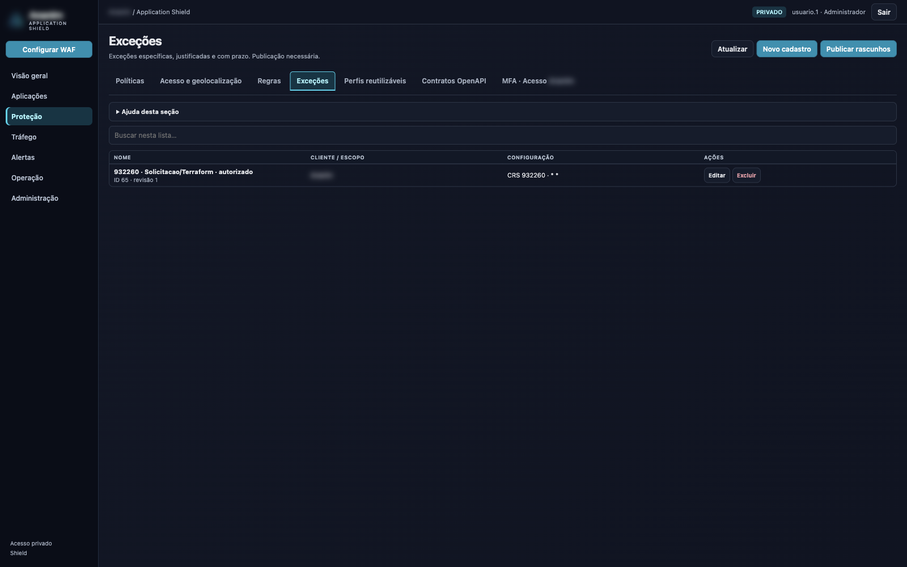 Exceções delimitadas</td><td width="33%">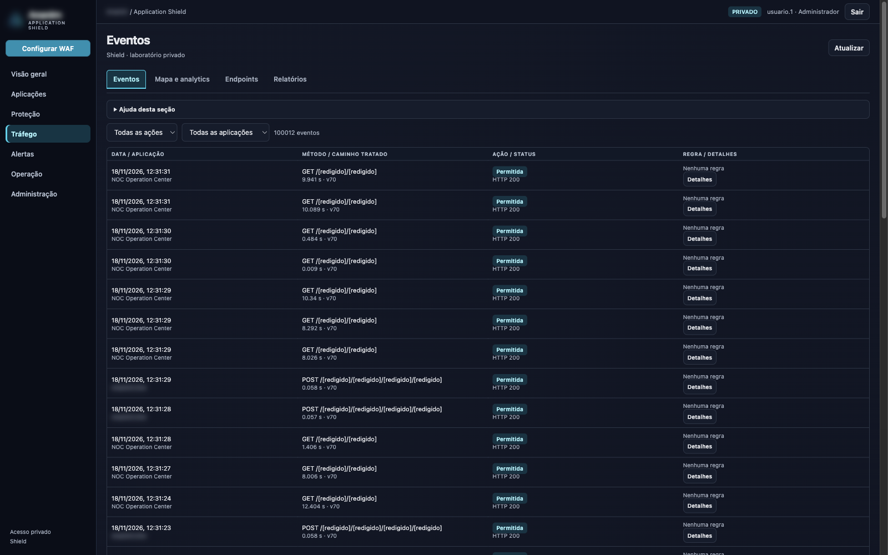 Eventos</td><td width="33%">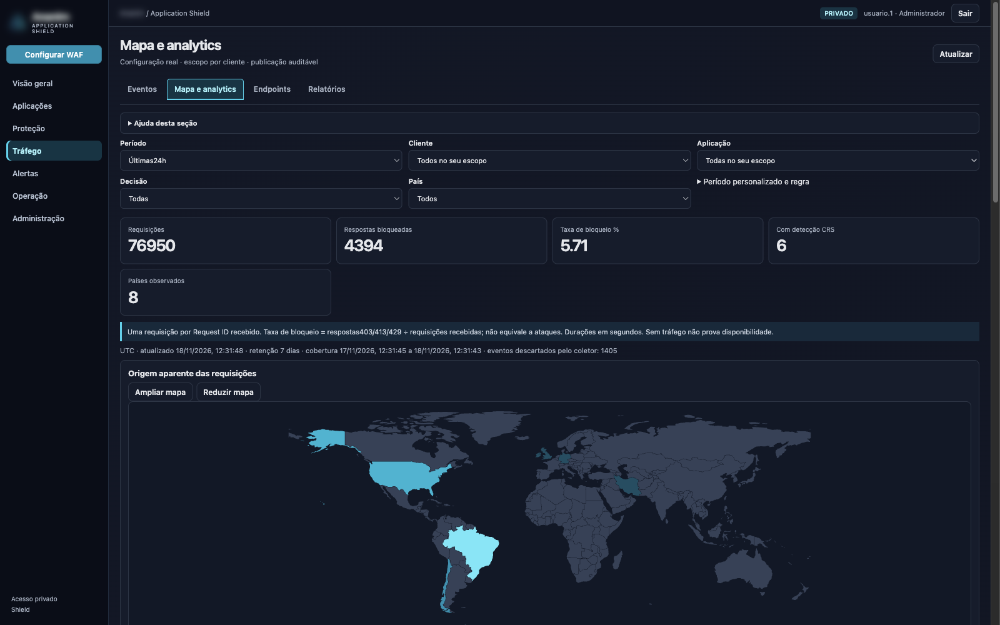 Mapa e analytics</td></tr></table>

## White-label e pronto para SaaS

O Shield foi construído para ser **white-label**. Nome, logo, cores, papel timbrado dos relatórios, lista de clientes, contas cloud e integrações são configuração — não estão fixos no código. A mesma plataforma pode ser:

- **implantada para qualquer empresa** — MSP, revenda de cloud, provedor de serviços gerenciados ou time interno de TI;
- **operada como single-tenant** (uma empresa, na própria infraestrutura) ou **multi-tenant**, com cada cliente isolado por escopo validado no backend;
- **oferecida como SaaS**, com onboarding por cliente, perfis de acesso e MFA já previstos no desenho.

Clientes, aplicações, origens, políticas e usuários são dados com escopo por cliente. Um provedor pode proteger as aplicações dos seus clientes a partir de um único painel, dar a cada cliente um login com escopo (leitor / operador) e manter a permissão global de publicação com a própria equipe.

Adaptar para uma nova empresa significa configurar marca, conectores e credenciais daquele ambiente e validar com os dados dela.

## Tour tela a tela

### 1. Visão geral

- Aplicações protegidas, requisições nas últimas 24 h, bloqueadas e limitadas.
- Mapa mundial da origem das requisições com bloqueio por geolocalização.
- Lista de aplicações por domínio com ativar/desativar, e saúde de cada componente: proxy, publicador, coletor de eventos, scanner.

### 2. Políticas e cobertura publicada

- Por aplicação, a proteção **publicada** contra cada família de ameaça do OWASP Core Rule Set: SQL injection, XSS, traversal, RFI, comandos do sistema, injeção PHP / Java / genérica, fixação de sessão, scanners, ataques ao protocolo HTTP e multipart.
- Mostra o estado realmente aplicado (bloqueio por pontuação) e detecções/bloqueios nas últimas 24 h — sem testes inventados.
- Editar política e ir direto aos eventos relacionados.

### 3. Acesso e geolocalização

- Bloqueio por país, listas de IP/CIDR e ASN por aplicação, via assistente guiado ou JSON validado.
- Revisão desejada × versão aplicada lado a lado, com histórico e comparação.
- **Simulador**: testa como a política desejada trataria um IP, rota e método — sem acessar a origem.

### 4. Exceções delimitadas

- Falsos positivos tratados com exceções específicas: ID da regra, caminho, escopo do cliente, justificativa e prazo.
- Exceções são rascunho até a publicação — sem liberação global.
- Na mesma seção: regras próprias avaliadas antes do CRS, perfis reutilizáveis, contratos OpenAPI e MFA para acesso protegido.

### 5. Eventos

- Cada decisão com aplicação, regra, ação, código de status e origem aparente.
- Dados sensíveis redigidos: caminhos e parâmetros ficam como `[redigido]`; corpo, cookies e credenciais não são persistidos.

### 6. Mapa e analytics

- Taxa de bloqueio, detecções CRS, países observados e volume de requisições no tempo, com retenção de 7 dias.
- Filtros por cliente, aplicação, decisão e país.

### 7. Relatórios

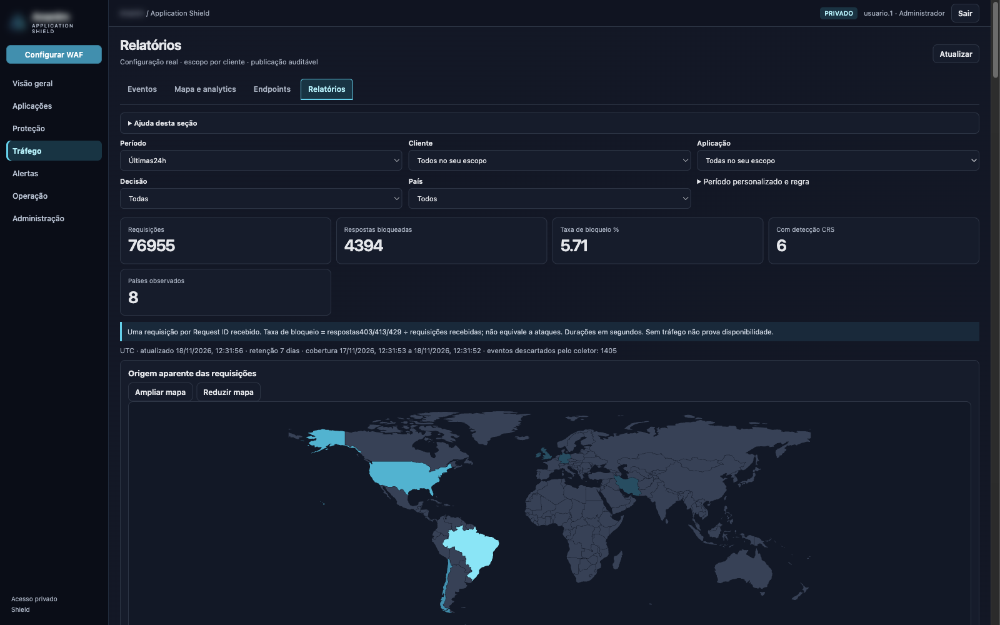

- Relatório de tráfego e segurança por período, cliente, aplicação, decisão e país — com janela de cobertura e descartes do coletor exibidos com transparência.
- Mapa de origem, principais regras, caminhos e endpoints.

### 8. Alertas

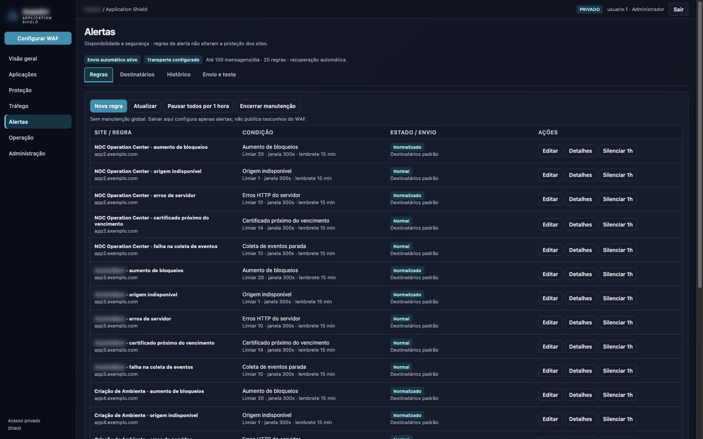

- Regras por aplicação: aumento de bloqueios, origem indisponível, erros HTTP do servidor, certificado perto do vencimento, coleta de eventos parada.
- Limiar, janela e lembrete por regra; destinatários, histórico, envio de teste; silenciar 1 h, pausar todos, modo manutenção.
- Regras de alerta nunca alteram a proteção.

### 9. Publicação versionada e rollback

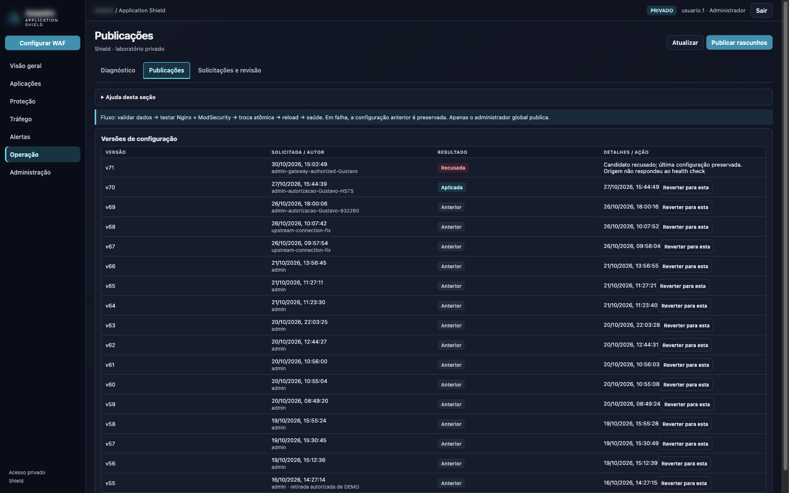

- Fluxo: validar dados → testar Nginx + ModSecurity → troca atômica → reload → health check. Se algo falhar, a configuração anterior é preservada.
- Cada versão listada com autor, resultado (aplicada / recusada / anterior) e **reverter com um clique**.
- Diagnóstico (DNS apontando para o WAF, alcance da origem) e fila de solicitações/revisão na mesma área.

### 10. Auditoria

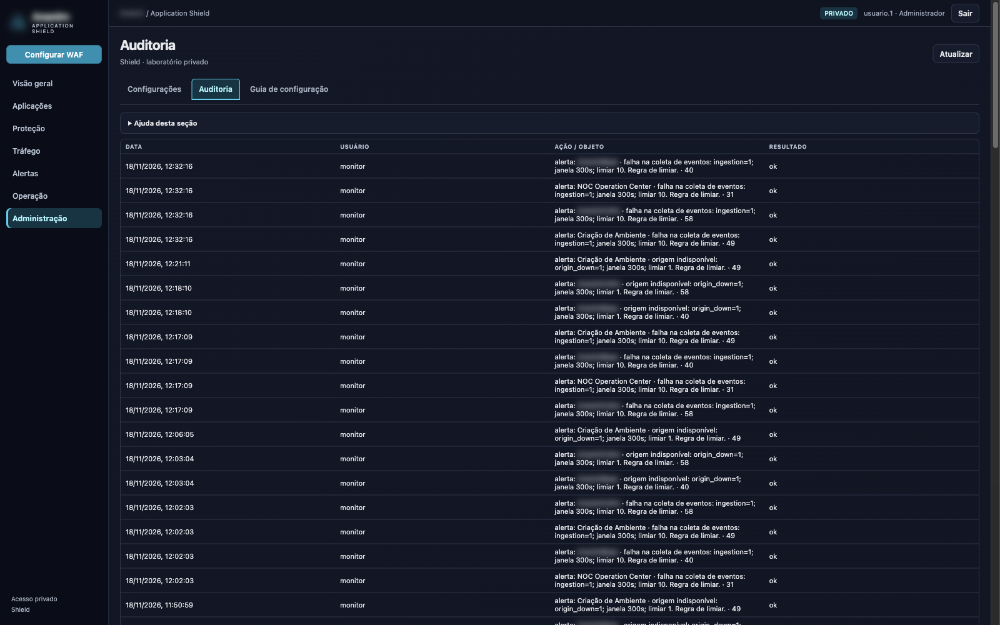

- Trilha de auditoria de toda ação de usuários e do monitor: quem, quando, qual objeto, resultado.
- Administração com SSO + MFA, perfis (Administrador / Operador / Leitor) por cliente e guia de configuração embutido.

## Como funciona

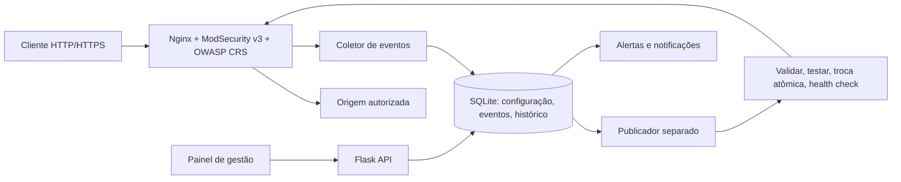

**Stack:** Nginx · ModSecurity v3 · OWASP CRS · Python · Flask · Gunicorn · SQLite · Docker · JavaScript · gateway SSO/MFA.

Decisões e limites de arquitetura: [ARCHITECTURE.md](ARCHITECTURE.md) · Evolução: [ROADMAP.md](ROADMAP.md) · Sobre as imagens: [VISUALS.md](VISUALS.md)

## Exemplo de uso

Uma aplicação começa em modo observação enquanto o tráfego legítimo é estudado. Um falso positivo é tratado com uma exceção específica, revisada e publicada. O publicador valida a candidata e verifica a saúde; se algo falhar, a configuração válida é mantida ou restaurada. Eventos e relatórios confirmam a decisão aplicada.

## Competências demonstradas

- Transformar requisitos de segurança em um painel utilizável e auditável.
- Separar plano de gestão e plano de tráfego (o backend web não tem acesso direto ao Docker).
- Gestão de mudança segura: rascunho, validação, publicação atômica, rollback.
- Privacidade por padrão nos logs (redação, sem corpo/cookies/credenciais).
- Documentação honesta do que um WAF cobre e do que não cobre.

## Limites importantes

- WAF não substitui correções na aplicação, autenticação, autorização ou proteção DDoS volumétrica.
- A eficácia depende do tráfego, configuração, tuning e atualização do motor e das regras.
- Alta disponibilidade e recuperação externa não são apresentadas como entregas concluídas.
- Não há afirmação de ausência de vulnerabilidades nem certificação de segurança.

## Código-fonte

O código-fonte é mantido em repositório privado. Este repositório é um portfólio: apenas documentação e imagens — sem código operacional, credenciais, acesso a ambientes ou dados de clientes. Marcas e componentes de terceiros permanecem sujeitos aos respectivos direitos e licenças.

## Projetos relacionados

- [NOC Operation Center](https://github.com/gsouzacloud/noc-operation-center-portfolio) — operação, correlação, usuários e segurança
- [Cloud Report](https://github.com/gsouzacloud/cloud-report-portfolio) — FinOps e governança cloud
- [Shield](https://github.com/gsouzacloud/shield-portfolio) — WAF e segurança de aplicações

[Gustavo Souza no GitHub](https://github.com/gsouzacloud) · Documentação atualizada em 18/11/2026.
